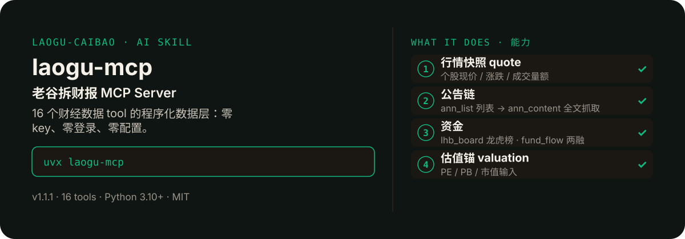

<!-- About 简介（推送后填写到仓库 About 栏）：
老谷拆财报 MCP Server：16 个财经数据 tool，一次装好随便调 ｜ 一键安装：uvx laogu-mcp
-->
<!-- topics（推送后打）：mcp, mcp-server, a-share, finance, chinese, eastmoney -->

<p align="center">
  
</p>

> 16 个「老谷拆财报」财经 skill 的程序化数据层：A 股行情、公告、龙虎榜、两融、解禁、估值……一次装好，16 个场景 tool 随便调。
>
> **零 key、零登录、零配置**：全部走公开接口，不用申请任何 token。
> 以数据为刃，剖市场真相 —— 个人观点，仅供参考，不构成投资建议。

**一键安装**：装好 Python 3.10+ 与 uv 后，一行启动

```bash
uvx laogu-mcp
```

## 它能帮你做什么

每个 tool 对应一个 laogu-* skill 的数据抓取部分；解读逻辑由宿主 LLM 按各 skill 的 Output Contract 执行（见 tool 描述）。契约动态同步：tool 描述在静态快照基础上，自动拼接 GitHub 最新版 skill 的 Output Contract（启动时同步）。

### 16 个 tool 一览

| tool | 对应 skill | 一句话 |
|---|---|---|
| `quote` | laogu-fundamentals | 个股行情快照（现价/涨跌/成交量额） |
| `ann_list` | laogu-announcements | 个股公告列表（含取正文的 art_code） |
| `code_verify` | laogu-news | 股票代码↔官方简称核对 |
| `market_snapshot` | laogu-morning | A股指数+美股+原油+黄金+离岸人民币 |
| `fund_flow` | laogu-moneyflow | 个股两融 / 全市场龙虎榜资金 Top |
| `close_recap` | laogu-close | 收盘指数快照 |
| `lhb_board` | laogu-lhb | 龙虎榜明细（自动回滚到最近交易日） |
| `ann_content` | laogu-report | 公告正文全文抓取（自动翻页） |
| `risk_inputs` | laogu-risk | 财务风险体检输入（行情+定期报告定位） |
| `earnings_ann` | laogu-earnings | 业绩预告/快报公告扫描 |
| `research_grounding` | laogu-research | 研报解读 grounding（代码核对+行情） |
| `ir_records` | laogu-notes | 投资者关系活动记录表搜索 |
| `unlock_notices` | laogu-unlock | 限售解禁公告搜索 |
| `ipo_calendar` | laogu-ipo | 打新日历（无公开接口时诚实返回搜索模板） |
| `valuation` | laogu-value | 估值锚输入（PE/PB/市值） |
| `macro_helper` | laogu-macro | 交易日校验+北京时间换算+宏观搜索模板 |

### 实证：冒烟测试

- 冒烟测试 18 次调用全部按设计通过（2026-09-29 实测，见 `smoke/mcp-smoke.md`）：16 项取到真实数据；2 项因无稳定公开接口而诚实返回 `ok:false` + 搜索模板，绝不编数——中文简称→代码（无稳定简称→代码接口，不猜测）、打新日历（无稳定公开程序化接口，不编造日历）。2026-11-09 沙盒重跑 18 次调用，结果一致（16 通过 + 2 诚实失败）。
- 返回格式是统一 JSON 信封：成功失败都一样的结构，失败时 `ok: false` 带 `reason` 和 `search_templates`（网页搜索关键词）；取不到的字段标 `null` 并在 `warnings` 说明，不估算。

## 30 秒装好（小白版）

1. 装 Python 3.10 或更新（[python.org](https://www.python.org/downloads/) 下载，一路"下一步"）。
2. 装 uv（命令行工具，复制粘贴下面一行）：
   - Windows（PowerShell）：`powershell -c "irm https://astral.sh/uv/install.ps1 | iex"`
   - Mac/Linux：`curl -LsSf https://astral.sh/uv/install.sh | sh`
3. 测试一行能跑：`uvx laogu-mcp`（看到启动日志即成功，按 Ctrl+C 退出）。

## Claude Desktop 配置

打开 Claude Desktop → 设置 → 开发者 → MCP 服务器 → 编辑配置文件，加入：

```json
{
  "mcpServers": {
    "laogu-mcp": {
      "command": "uvx",
      "args": ["laogu-mcp"]
    }
  }
}
```

保存后重启 Claude Desktop，对话框输入框下方出现 🔌 图标即装好。

## Cherry Studio 配置

设置 → MCP 服务器 → 添加服务器 → 类型选"标准输入输出 (stdio)"：

- 名称：`laogu-mcp`
- 命令：`uvx`
- 参数：`laogu-mcp`

保存后开关打开，状态显示"已连接"即成功。

## 返回格式

统一 JSON 信封，成功失败都一样的结构：

```json
{
  "ok": true,
  "data": { "...": "..." },
  "meta": {"source": "新浪行情", "fetched_at": "2026-09-29 03:55:00", "timezone": "北京时间"},
  "warnings": ["腾讯行情不可用，已降级到新浪行情"]
}
```

失败时 `ok: false`，带 `reason` 和 `search_templates`（网页搜索关键词），**绝不编数字**。
取不到的字段标 `null` 并在 `warnings` 说明，不估算。

## 诚实纪律（和 16 个 skill 同标准）

- 关键数据带日期时点和来源；单源数据标注来源。
- 北向"净流入/净买入"口径已死（2024-08-19 起），本 server 不输出该数字。
- 只做数据抓取，解读由宿主 LLM 按各 skill 的 Output Contract 执行；**不做买卖推荐**。
- 公共接口不提供具体龙虎榜营业部，绝不编造。

## 数据源实测状态（2026-09-29）

| 接口 | 状态 |
|---|---|
| 新浪行情（含指数/美股/期货/外汇） | ✅ |
| 东财公告列表 / 正文 | ✅ |
| 东财龙虎榜 / 两融 | ✅ |
| 腾讯行情 | ⚠️ 部分网络超时（自动降级） |
| 东财 push2 | ⚠️ 部分网络 502（自动降级） |

## 开发

```bash
git clone https://github.com/laogu-caibao/laogu-mcp
cd laogu-mcp
uv venv && uv pip install -e .
python smoke/run.py   # 冒烟测试（真实数据）
```

## 目录结构

```
laogu-mcp/
├── src/laogu_mcp/  # server.py（16 个 tool）+ _sources.py（公开接口层）+ _contracts.py（契约同步）+ _config.py
├── smoke/  # 冒烟测试：run.py（真实数据）+ results.json + mcp-smoke.md（2026-09-29 实测报告）
├── tests/  # test_config.py
├── packaging/  # .mcpb 打包
├── server.json  # MCP server 清单（v1.1.1）
├── smithery.yaml  # Smithery 发布配置
├── pyproject.toml  # 打包配置（v1.1.1）
├── DESIGN.md  # 设计文档
├── MARKET.md  # 市场调研
├── config-schema.md  # 配置说明
├── LICENSE  # MIT
└── README.md  # 本文件
```

## 自检与反馈

本仓库自带冒烟测试（真实数据）：

```bash
python smoke/run.py   # 18 次调用：16 项取真实数据 + 2 项诚实失败（见上）
```

发现 bug 或有改进建议，以 `[QC] <一句话问题>` 为标题提交到 https://github.com/laogu-caibao/laogu-mcp/issues，正文写清“复现步骤 → 实际表现 → 期望表现”。

## English

**laogu-mcp — MCP data server.** The programmatic data layer behind the skills: 16 finance tools (quotes, filings, dragon-tiger list, margin data, unlocks, valuation). Zero API keys, zero login, zero config — public endpoints only. Install: `uvx laogu-mcp`.

## FAQ

**Q：laogu-mcp 有什么用？**
适合的场景：不想逐个装 skill，只想在任意支持 MCP 的客户端里直接调 16 个 A 股财经数据工具（零 key）。

**Q：数据可靠吗？会荐股吗？**
数字必须来自可核验的公开来源（上市公司公告、交易所公开数据、公开网页），取不到就标「未核验」，绝不编造；只做数据抓取与结构化整理，不构成投资建议。

**Q：怎么安装？支持哪些客户端？**
```bash
uvx laogu-mcp
```
支持 Claude Desktop、Cherry Studio 与任意支持 MCP（stdio）的客户端，配置见上文。更多 skill 见[老谷拆财报组织主页](https://github.com/laogu-caibao)。

## 出品

—— 老谷拆财报 · laogu-mcp · 出品：老谷拆财报（抖音/视频号/头条/快手同名）
个人观点，仅供参考，不构成投资建议

---

---
